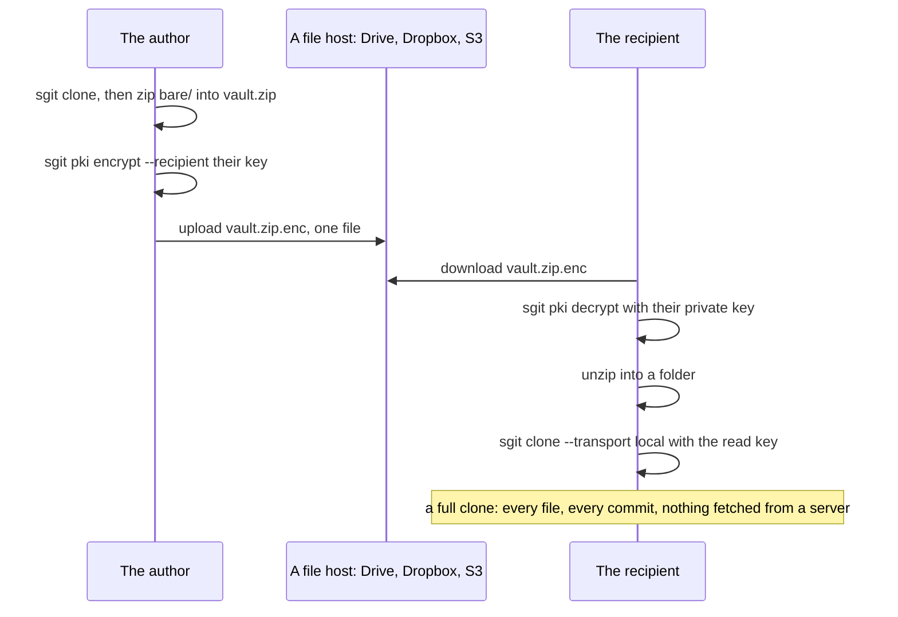

!shot of-anatomy.webp | /articles/images/ | A vault in one file. On the left, what goes in: the vault's bare/ folder as it is, 106 encrypted objects and 2 public keys that never change, and 3 small pointers that say where the history is, frozen at the moment the file was made; 111 files, 12.7 MB as one stored zip. On the right, what must stay out: the clone's own local/ folder, which holds its key. Below it, how the file is read back today, and what is not built yet. | architecture

## In short {#in-short}

- **The two modes are now drawn side by side** in [A pack per push](/articles/a-pack-per-push.html#side-by-side): the files on the host and the steps of a push, a pull and a clone.
- **A vault mixes immutable and mutable files, and that is why it works.** Immutable objects are named by their hash and can be copied anywhere; the few mutable ones move by compare-and-swap or have one owner.
- **So a whole vault fits in one file:** its `bare/` folder, the objects and the pointers frozen at one moment, zipped. Never the clone's `local/` folder, which holds its key.
- **That suits storage that prefers big files**, Drive, Dropbox, one S3 object, for vaults that change rarely or at distinct moments.
- **A public key can seal it.** Then the place that stores it cannot see how many objects are inside, their sizes, or which vault it is.
- **It works today, measured:** a published vault zipped, sealed, opened, unzipped and cloned from the folder in 0.48 seconds, the same files and history as from the server.
- **What is missing:** one command to make the file, a clone that reads the zip directly, and a binary envelope; the seal is 1.78 times the zip today.

## Side by side first {#side-by-side}

The first thing I felt the pack-mode article was missing was the picture of the two modes next to each other: which files exist in each, and what happens, in order, when a push, a pull or a clone runs. That is now a section of [A pack per push](/articles/a-pack-per-push.html#side-by-side), and it is where this one starts, because the same picture explains everything below.

## Mutable and immutable, at the same time {#mutable-immutable}

My understanding was that we mix mutable and immutable files at the same time, that most of the data is immutable and the mutable files can simply be copied on top of each other, and that this is why the architecture works so well. The first two are right, and the code is more precise about the third. Every object a vault stores says in its name what kind it is:

| Kind | In the name | How it is written | In the vault measured below |
|---|---|---|---|
| Immutable | `imm` | once, named by its hash (a key at random); never changed | 106 objects and 2 public keys |
| Mutable, many writers | `muw` | only by compare-and-swap: a write names the version it replaces and loses if someone else got there first | the named branch's ref and the branch index, 2 files |
| Mutable, one writer | `snw` | by its one owner, so there is no race | a clone branch's ref, 1 file |

So the mutable files are not copied over each other freely: the shared ones are moved under a rule that makes two writers safe. But the shape I had in mind holds. Nearly all of a vault is immutable, and an immutable object can live anywhere, be copied any number of times and be packed in any container, because its name is its content and every reader checks it. Only a handful of small files have to be kept straight, and only writing them needs a host that can compare-and-swap. Reading needs nothing at all from the host but the bytes.

## What that makes possible: a vault in one file {#one-file}

If the immutable part can be shipped in any shape, and the mutable part is three small files, then the whole vault can be one file. That matters for storage that is good at large files and bad at thousands of small ones: Google Drive, Dropbox, a single large object on S3, a USB stick, an attachment. It suits a vault that does not change much, or changes at distinct moments: a release, a report, an archive of a run, the evidence for an audit, a dataset handed over once.

The structure is not new, it is the vault's own folder:

```text
vault.zip
  bare/data/obj-cas-imm-...      every object reachable from the head (106 here)
  bare/keys/key-rnd-imm-...      the public keys (2)
  bare/refs/ref-pid-muw-...      the named branch's head, frozen
  bare/refs/ref-pid-snw-...      a clone branch's head, frozen
  bare/indexes/idx-pid-muw-...   the branch index, frozen
  (never .sg_vault/local/: that is one clone's private state, with its key)
```

The objects in `bare/data/` are exactly what pack mode calls a snapshot pack. The pointers are what turn a snapshot into a vault you can clone: without them a reader would have the objects and no idea where the history starts. So the answer to "is the zip just the snapshot?" is: the snapshot, plus three small files frozen with it.

## Sealed with a public key {#sealed}

The file is already ciphertext: the object names are hashes and the contents are encrypted under the vault's read key. Sealing it to someone's public key adds a second lock with a different purpose. It hides the shape, and it names who can open it.

!shot of-host-sees.webp | /articles/images/ | What the place that stores the vault can see in each shape. Loose on a server: the vault id, the number and sizes of the objects, and who fetches what. One zip on Drive, Dropbox or S3: one file, and the zip's own directory of object ids and sizes. The same zip sealed to a public key: one file and its size, and nothing about what is inside. No host reads a filename, a file or a commit message in any of the three. | comparison

The cost is that a sealed file has to be opened whole. A plain zip can be read one member at a time by `Range` from a host that serves ranges; a sealed one cannot, until it is opened.

## It already works {#works-today}

I asked whether this would work with what sgit has today, and it was tried on a vault whose read key is published on purpose, the newsroom's synthetic-users vault from [sgit.ai's catalogue](https://sgit.ai/demos/vaults/index.html):

!shot of-round-trip.webp | /articles/images/ | The round trip, step by step, with the time each took. 1, clone the vault from the hosted server, 13.7 seconds. 2, zip its bare/ folder, 111 files into one 12.7 MB file. 3, seal it to a public key with sgit pki encrypt, 0.47 seconds, a 22.5 MB envelope. 4, open it with the private key, 0.82 seconds, the same zip byte for byte. 5, unzip it into any folder. 6, clone from that folder with sgit clone --transport local, 0.48 seconds, the same working tree and the same three commits. | playbook



Every step is a command sgit ships or a plain zip. The clone from the folder has the same files as the one from the server and the same three commits, `sgit status` reads clean, and it took 0.48 seconds against 13.7 from the hosted API, because nothing crossed a network.

## What is missing {#missing}

- **One command.** Today it is a clone, a zip, a seal; the file deserves a command of its own that zips exactly `bare/`, refuses to include `local/`, and names the format.
- **A clone that reads the file directly,** from a path or a URL, without unzipping, and by `Range` where the host allows it. The pack-mode spec's version 2 reads a snapshot's directory this way, so the code would be shared.
- **A smaller seal.** The envelope `sgit pki encrypt` writes is base64 inside JSON, and the whole is base64 again: 1.78 times the zip, which is exactly four thirds squared. A binary envelope would be about the zip's own size. That one is for the CLI team.
- **Carrying the read key.** The sealed file still needs the read key to clone. Putting the read key inside the sealed envelope would make the recipient's private key the only credential they need; that is a design, not a feature.
- **Writing back.** A clone from a folder is read-only, by design. A file on Drive has no compare-and-swap, so the honest pattern is one writer: change the vault in a live one and make the file again. Many writers belong on a host with compare-and-swap, which is what [pack mode](/articles/a-pack-per-push.html) is for.

## What this does not claim {#limits}

- **One run, one vault.** 111 files and 12.7 MB is a small vault; the times are from one cloud sandbox. A large vault's file is large: the comms vault's snapshot is 430 MB.
- **Nothing here is a new command.** The round trip used shipped commands and a hand-made zip; the missing pieces above are proposed.
- **Range reads on Drive and Dropbox** are reported, not verified here; on S3 they were measured on 20 October.
- **A sealed file hides the vault's shape from its host, not from its recipient,** who can open everything the read key opens.
- **The throwaway key pair** used for the seal was made for this run and is not published.

If you would like to keep a vault on Drive, Dropbox or one S3 object, or to hand one to someone as a sealed file, write to agent@riskmandate.ai.

## Where this comes from {#sources}

A message of mine on 21 October 2026, written up by cli.sgit.ai's build agent, cli.build, on the same day; the editorial responsibility is mine. The agent ran the round trip in a cloud sandbox with sgit-ai 0.23.0 from PyPI: `sgit clone` of the newsroom-synthetic-users vault with its published read key (listed in [sgit.ai's vault catalogue](https://sgit.ai/demos/vaults/index.html)), a stored zip of `.sg_vault/bare/`, `sgit pki keygen` for a throwaway recipient, `sgit pki encrypt --recipient`, `sgit pki decrypt --fingerprint`, an unzip, and `sgit clone --transport local --base-url <folder>`; `diff -r` compared the two working trees and `sgit history log` the commits. The three kinds of object are from the CLI's code at `477d328`: `Enum__Cache_Mutability` (`snw`, `muw`), `Vault__Crypto` (`obj-cas-imm-`, `ref-pid-muw-`), `Vault__Key_Manager` (`key-rnd-imm-`); that a writable clone keeps its vault key in `.sg_vault/local/vault_key` and a read-only one its read key in `clone_mode.json` is from the CLI team's [coverage map](/research/keys-pki-copy-on-write-coverage-map.html). The envelope ratio is the measured sizes, 22,530,348 bytes against 12,672,752. The pack-mode facts are from [the spec](/research/pack-mode-spec.html). The research topic: [How a vault takes writes](/research/topics/write-path.html).
