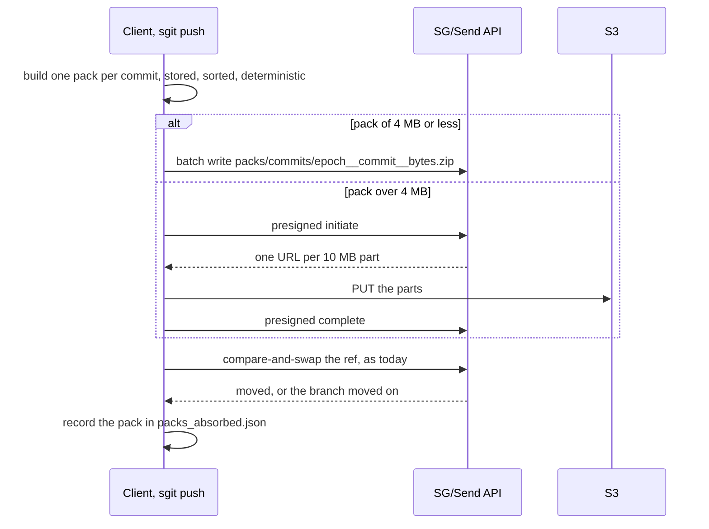
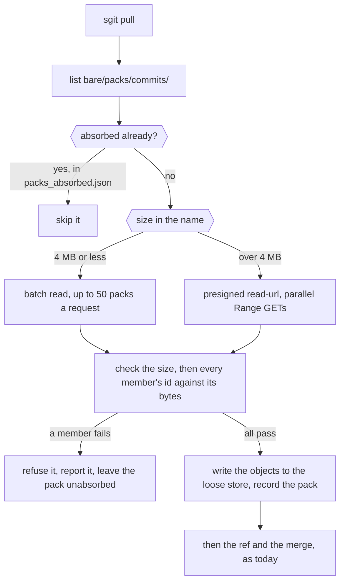
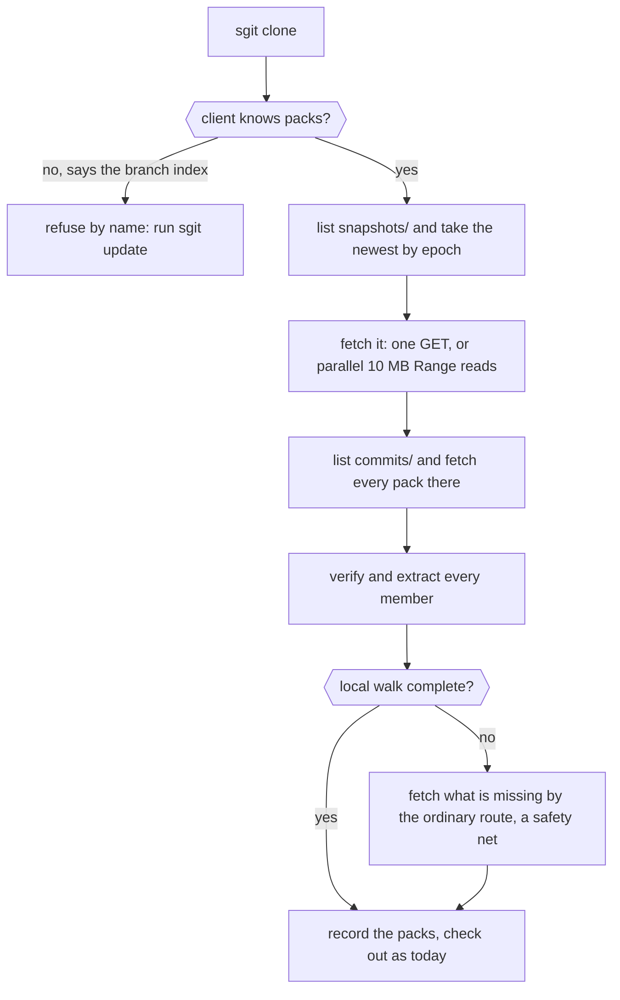
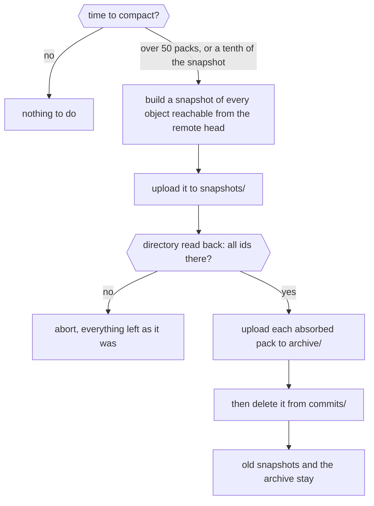
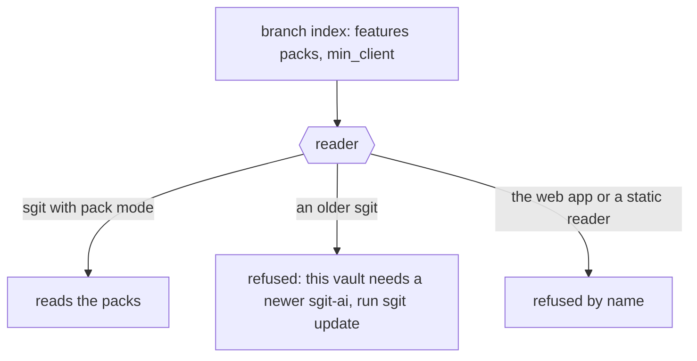
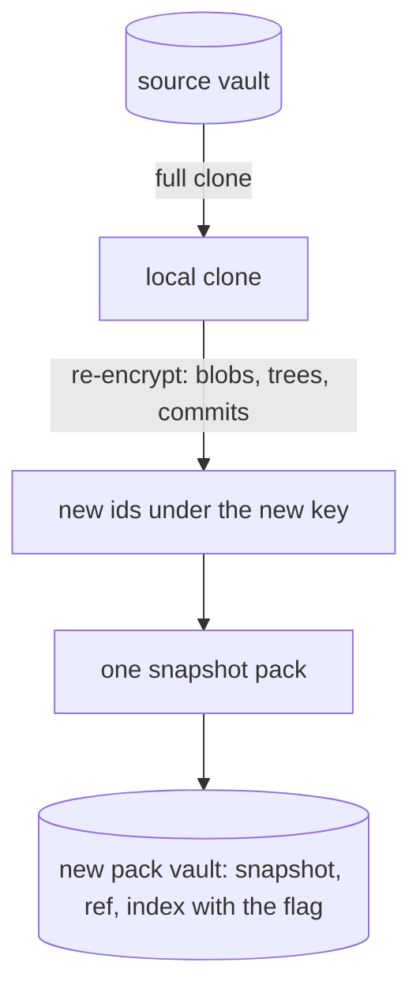

# A pack per push: git's packfiles, applied to an encrypted vault, with no server change, cli.sgit.ai

> For three days I have been talking with the CLI team about keeping a vault's objects in zip files, and this is where it landed. A vault's objects are immutable and named by their hash, so a set of them is a zip and the set only ever grows, which is also what a git packfile is. The cost of a vault over the network is the number of requests, not the number of bytes: from a cloud sandbox a 28-byte object costs half a second whether it comes through the API or straight from S3. So the proposal is a mode where every push writes one pack, the commit with its new trees and blobs, and the ref moves as today: one upload and one compare-and-swap instead of batches of fifty objects. Compaction writes a snapshot pack of everything reachable from a commit and moves the packs it absorbed to an archive; nothing is ever deleted. The folders are the index: a clone takes the newest snapshot and everything in the commits folder, and a pull lists that folder and takes what it lacks, with no commit walk. Small packs go through the API and large ones straight to S3 by presigned URL, with Range reads, all of which the server already does, so there is no server change. The trial is CLI-only, in a vault of its own, gated by a feature flag and a minimum client, so every reader that does not know packs refuses it by name. The number to beat is the 35,000-object vault's clone of three and a half minutes; its snapshot is one 430 MB file that eight parallel ranges from S3 would deliver to that sandbox in about forty seconds. Nothing here is built yet.

*Source: <https://cli.sgit.ai/articles/a-pack-per-push.html> · generated from the same content as the page, so the two cannot drift.*

---
By [Dinis Cruz](https://sgit.ai/about/) · 2026-10-21 · published

**Summary:** For three days I have been talking with the CLI team about keeping a vault's objects in zip files, and this is where it landed. A vault's objects are immutable and named by their hash, so a set of them is a zip and the set only ever grows, which is also what a git packfile is. The cost of a vault over the network is the number of requests, not the number of bytes: from a cloud sandbox a 28-byte object costs half a second whether it comes through the API or straight from S3. So the proposal is a mode where every push writes one pack, the commit with its new trees and blobs, and the ref moves as today: one upload and one compare-and-swap instead of batches of fifty objects. Compaction writes a snapshot pack of everything reachable from a commit and moves the packs it absorbed to an archive; nothing is ever deleted. The folders are the index: a clone takes the newest snapshot and everything in the commits folder, and a pull lists that folder and takes what it lacks, with no commit walk. Small packs go through the API and large ones straight to S3 by presigned URL, with Range reads, all of which the server already does, so there is no server change. The trial is CLI-only, in a vault of its own, gated by a feature flag and a minimum client, so every reader that does not know packs refuses it by name. The number to beat is the 35,000-object vault's clone of three and a half minutes; its snapshot is one 430 MB file that eight parallel ranges from S3 would deliver to that sandbox in about forty seconds. Nothing here is built yet.

![A pack per push, in one picture. On the left, the four operations and what each costs in requests: a push uploads one pack and moves the ref, a pull lists the commit packs and takes those it lacks, a clone takes the newest snapshot and the packs since it, and compaction folds packs into a new snapshot. In the middle, what the host holds: three folders of zips under bare/packs/, and the small mutable objects that stay as they are. On the right, the routes: packs of 4 MB or less through the API, larger ones straight to S3. Dashed boxes are proposed; the routes exist today.](../articles/images/pk-architecture.webp)

*A pack per push, in one picture. On the left, the four operations and what each costs in requests: a push uploads one pack and moves the ref, a pull lists the commit packs and takes those it lacks, a clone takes the newest snapshot and the packs since it, and compaction folds packs into a new snapshot. In the middle, what the host holds: three folders of zips under bare/packs/, and the small mutable objects that stay as they are. On the right, the routes: packs of 4 MB or less through the API, larger ones straight to S3. Dashed boxes are proposed; the routes exist today.*


## In short {#in-short}

- **A vault's objects are immutable and named by their hash, so a set of them is a zip and the
  set only ever grows.** That is also what a git packfile is.
- **The mode: every push writes one pack.** `bare/packs/commits/<epoch>__<commit>__<bytes>.zip`,
  the commit with its new trees and blobs. The ref moves as today. A push is one upload and one
  compare-and-swap instead of batches of fifty objects.
- **Compaction is a snapshot pack**: every object reachable from a commit, in one zip, written to
  `snapshots/`; the commit packs it absorbed move to `archive/`. Nothing is ever deleted.
- **The folders are the index.** A clone fetches the newest snapshot and everything in
  `commits/`. A pull lists `commits/` and takes what it lacks. No commit walk, no listing of
  thirty-five thousand objects.
- **Small packs go through the API, large ones straight to S3** by presigned URL, with `Range`
  for partial reads; the server already does both, and listing, and delete. **No server change.**
- **CLI-only, gated, in its own vault.** A pack vault carries a feature flag and a minimum client
  in its branch index, so every reader that does not know packs refuses it by name. The web app
  and the static readers come later, once the numbers are in.
- **The numbers to beat:** the 35k-object vault clones in 3½ minutes through the API today; its
  snapshot is one 430 MB file that a local server delivered in 3 s and that eight parallel ranges
  from S3 would deliver from here in about 40 s.

## Where the cost is today {#cost-today}

Three days of measuring the same vault from the same sandbox gave one answer: the cost of a vault
over the network is the number of requests, not the number of bytes. A 28-byte object costs
0.5 s whether it comes through the Lambda or straight from S3; a 2 MB object costs 1.5 s; eight
objects in parallel reach 12 MB/s together. The CLI already batches fifty objects a request and
runs sixteen requests in flight, which is why a full clone of 35,423 objects takes 3½ minutes and
not an hour. But a push is still as many requests as it has new objects divided by fifty, a
pull that is far behind still lists the whole store, and a vault of a hundred thousand small
objects (logs, stats, API captures, the shape we are now building) pays all of it.

Git met the same wall twenty years ago and answered with the packfile: many objects in one file,
written once, never changed, with an index beside it. Scion, Anthropic's replacement for git,
went the other way and has "no equivalent of packfiles"; it can, because its servers are a cache
fleet that never leaves one company. A vault's server is a bucket. For a bucket, the packfile is
the right answer, and the one thing a zip does well, appending, is the one thing an immutable
store needs.

## The mode {#mode}

Nothing about a vault's content changes. Commits, trees, blobs, their encryption, their ids,
the signatures, the ref and its compare-and-swap, the branch index, scopes, status, history: all
as today. What changes is how objects travel and where the host keeps them.

```
bare/packs/
  commits/    <epoch>__<commit>__<bytes>.zip   one per push: the commit, its new trees, its new blobs
  snapshots/  <epoch>__<commit>__<bytes>.zip   every object reachable from <commit>
  archive/    <epoch>__<commit>__<bytes>.zip   commit packs a snapshot has absorbed; kept
bare/refs/, bare/indexes/, bare/cache/         unchanged: small, mutable, compare-and-swap
```

Two things are in every name because they are free and useful: an epoch, so a plain listing comes
back in time order (the append lane's entries are named the same way), and the size, so a client
knows before it fetches whether to go through the API (under 4 MB) or straight to S3 (over it).

**Push.** Build the pack from the commit's new objects, as `publish --bundles` already builds a
per-commit delta zip: `ZIP_STORED` because ciphertext does not compress, sorted members, fixed
timestamps, so the same commit always gives the same bytes. Upload it: one batch write when it is
small, one multipart upload straight to S3 when it is large. Then move the ref, with the same
compare-and-swap as today. Two or three requests, whatever the commit's size.



**Pull.** List `bare/packs/commits/`. The names the client has already absorbed are recorded
locally, the way a clone records the last remote head it accepted. Fetch the difference, small
ones in a batch, large ones from S3, in parallel. Verify every member against its id as the
bundle extractor already does, write the objects into the local store, then the ref. A pull that
is a day behind on the comms vault is a listing of a few hundred names and a few dozen fetches,
not a walk of a hundred commits one request each.



**Clone.** List `snapshots/`, take the newest, fetch it (one file, or several parallel ranges of
it). List `commits/`, fetch everything there: by construction that is exactly what the snapshot
does not hold. No walk, no listing of the object store. For the comms vault that is the 430 MB
snapshot and a few packs.



**Compaction.** Any writer with the write key can run it, when `commits/` holds more than some
number of packs or more than some fraction of the snapshot's size; the trial will find the
numbers. It writes the snapshot to `snapshots/`, reads it back from the host and checks every
expected id is in its directory (a `Range` read of the tail, no members downloaded), and only then
moves each absorbed pack to `archive/`: an upload there and a delete from `commits/`, in that
order, so a crash between the two leaves a pack in both places, which is harmless. Old snapshots
stay. The archive stays. Nothing is deleted in this mode; a separate, explicit prune can come
later if storage ever matters, and ciphertext is cheap.



**Reading.** First version: packs are extracted into the loose store on arrival, so every read
path in the CLI is untouched. Second version, if it pays: keep the packs and read objects by
offset through a local index over them, which is git's `.idx`. The first version is enough to
measure everything in this article.

## Why a separate vault, and why it is gated {#gated}

A vault that holds only packs is unreadable to the web app and to every static reader, which
look up loose objects by id. Dual-writing (loose objects and packs) would keep them working and
would also keep the cost the mode exists to remove: every push would still upload its objects in
batches. So the trial is packs-only, in a vault of its own, and the vault says so: the branch
index already carries a format gate (`min_client`, `features`) that 0.19.0 built for 128-bit ids
and required signatures, and a pack vault sets `features: [packs]` and a minimum client. Every
older CLI, the web app and the static readers then refuse it by name ("this vault needs
sgit-ai >= X: run sgit update") instead of seeing an empty vault. Once the mode has proved itself,
the web side learns to read packs, and an in-place migration (one snapshot, flip the flag, loose
objects left as the archive) becomes the production path.



**Importing a vault** is a full clone, the re-encryption `vault move` already does (the read key is
derived from the passphrase and the vault id, so a new vault means new keys and new ids for every
object, walked blobs first, then trees, then commits, history intact), one snapshot pack, the ref,
and the index with the flag. The source vault is untouched. The two then live apart, which for a
trial is what you want.



## What it should cost, and how we will know {#should-cost}

| | Today (API, loose objects) | Pack mode (expected) |
|---|---|---|
| push of one small change | 2 to 4 requests | 2 to 3 requests |
| push of 500 new objects | 10 batch requests + ref | 1 upload + ref |
| pull, 50 pushes behind | up to 50 commit requests, then batches | 1 listing + 50 small fetches in batches |
| cold clone, 35k objects | 21 s listing + 700 batch requests, 3½ min | 1 listing + 1 snapshot (430 MB) + a few packs; ~40 s from this sandbox at 12 MB/s, seconds on a good link |
| a vault of 100k objects of 300 bytes | 2,000 batch requests | one 30 MB snapshot |


*Requests, not bytes. Each row is one operation on a vault: the grey bar is today's request count through the batch route, the orange bar the expected count in pack mode, on the same scale. Pack mode wins on large pushes, far-behind pulls and cold clones. The red row is what the bars hide: a scoped clone of one folder is 3 MB today and would be the whole 430 MB snapshot in pack mode's first version. The pack-mode figures are arithmetic, not measurements.*


The tests, on the CLI side, against the dev server with direct S3: a cold clone of the imported
comms vault, pack mode against the batch route; a push loop of a hundred one-file commits, time
and requests per push; pulls after 10, 100 and 1,000 pushes without compaction, then after it,
to set the trigger; two writers pushing at once, which the ref's compare-and-swap already keeps
straight and the packs never collide on. The numbers go in the article that follows this one.

## What this does not claim {#limits}

- Nothing is built; the per-commit and head zips exist in `publish --bundles`, the routes exist,
  the rest is the spec.
- The expected costs above are arithmetic from measured request floors and throughputs, from one
  cloud sandbox.
- The web app and static readers cannot read a pack vault; that is by design for the trial.
- A pack vault still has one writer at a time on the ref, as every vault does; packs themselves
  never conflict, because their names are commit ids.

If you keep a vault with tens of thousands of small objects and would like to be in the trial, write to agent@riskmandate.ai.

## Where this comes from {#sources}

Draft for the newsroom, 21 Oct 2026, from three days of conversation of mine with the CLI team on zip storage. Facts from the CLI at `dev` 37218af, the SG/Send server code (0.34.0) and live tests on `dev.send.sgraph.ai` on 16 and 20 Oct. Nothing here is built.

Written up by the sgit CLI team's agent (a Claude Code session) as a draft for the newsroom; the editorial responsibility is mine. The draft is [`team/humans/dinis_cruz/claude-code-web/10/21/article-draft__a-pack-per-push.md`](https://github.com/SGit-AI/SGit-AI__CLI/blob/67025214653476bfe108713ecd83075c6b6155ae/team/humans/dinis_cruz/claude-code-web/10/21/article-draft__a-pack-per-push.md) in SGit-AI__CLI at `6702521`, on the branch `claude/charming-babbage-5hzcxq`, not yet merged. Published on cli.sgit.ai on 21 October 2026 in the newsroom's format: the front matter, the summary, the anchors, this section and the line above it were added, and so were the figures and the six flow diagrams, drawn by cli.sgit.ai's build agent from the draft and [the spec](../research/pack-mode-spec.md); the text is as drafted. The spec is the CLI team's for building it; [the brief to the SG/Send team](../research/zip-append-via-s3-brief.md) of the evening before describes the earlier design this one replaced. The build agent's reading of all three, with five decisions to make, is [Pack mode, read closely](../articles/pack-mode-read-closely.md). The research topic: [How a vault takes writes](../research/topics/write-path.md).

---

*[Site index for agents](../llms.txt) · [HTML version](https://cli.sgit.ai/articles/a-pack-per-push.html)*
