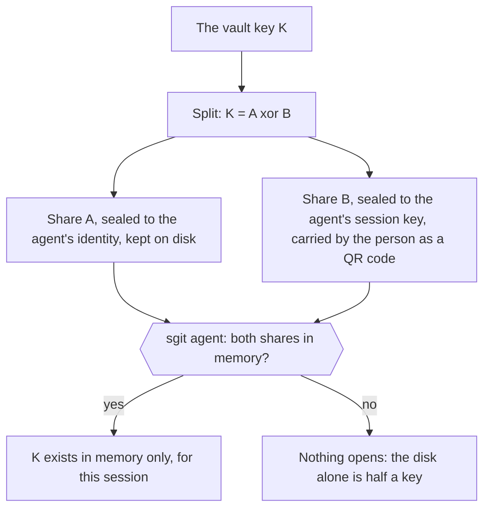

# A second factor without a server: why an authenticator app's code cannot protect a vault, why a passkey or a security key can, and what the second factor is for an agent, cli.sgit.ai

> With sgit keeping keys sealed and opening them only in memory, the next question I asked was about two-factor authentication. I have Google Authenticator on my phone, LastPass, passkeys, a YubiKey. Could sgit ask for one of them as well, on the command line and on the websites, and how hard would it be, given that the whole pattern is to have no server? Working it through changed the question. Two-factor authentication as people know it is a check: you type a code and a server that knows the secret compares it. Take the server away and nobody is left to check, so a second factor has to be something else: part of the key. The decryption must need bytes that only the second factor can produce. An authenticator app cannot do that. Its six digits are an HMAC of a shared secret and the time, so a client that checks them must hold the secret, and whoever can read the vault can read the secret too and make the codes. Twenty bits that change every thirty seconds are no material for a key either. A passkey can. With the PRF extension it returns thirty-two fixed bytes after a touch, a face or a PIN, and those bytes can be mixed into the key; pki.sgit.ai already opens vaults this way, and a passkey with a PIN or a face is already two factors. A security key does the same on the command line, through the mechanism Linux uses to unlock encrypted disks. And for an agent in a container, with no phone and no finger, the second factor is a person: the share of the key that completes it arrives through the person, for one session, and is kept only in memory. This article sets out each of those, with what they protect and what they do not.

*Source: <https://cli.sgit.ai/articles/a-second-factor-without-a-server.html> · generated from the same content as the page, so the two cannot drift.*

---
By [Dinis Cruz](https://sgit.ai/about/) · 2026-10-24 · published

**Summary:** With sgit keeping keys sealed and opening them only in memory, the next question I asked was about two-factor authentication. I have Google Authenticator on my phone, LastPass, passkeys, a YubiKey. Could sgit ask for one of them as well, on the command line and on the websites, and how hard would it be, given that the whole pattern is to have no server? Working it through changed the question. Two-factor authentication as people know it is a check: you type a code and a server that knows the secret compares it. Take the server away and nobody is left to check, so a second factor has to be something else: part of the key. The decryption must need bytes that only the second factor can produce. An authenticator app cannot do that. Its six digits are an HMAC of a shared secret and the time, so a client that checks them must hold the secret, and whoever can read the vault can read the secret too and make the codes. Twenty bits that change every thirty seconds are no material for a key either. A passkey can. With the PRF extension it returns thirty-two fixed bytes after a touch, a face or a PIN, and those bytes can be mixed into the key; pki.sgit.ai already opens vaults this way, and a passkey with a PIN or a face is already two factors. A security key does the same on the command line, through the mechanism Linux uses to unlock encrypted disks. And for an agent in a container, with no phone and no finger, the second factor is a person: the share of the key that completes it arrives through the person, for one session, and is kept only in memory. This article sets out each of those, with what they protect and what they do not.

![Without a server, a second factor has to be part of the key, not a code someone checks. Four candidates. An authenticator app's code (TOTP, as in Google Authenticator, Authy or LastPass): a code, not a key, because checking it needs the shared secret, and about twenty bits that change every thirty seconds cannot be part of a key. A passkey with the PRF extension: a key, in the browser, already used by pki.sgit.ai, supported by iCloud Keychain and Google Password Manager, reported for Windows Hello since early 2026 and mixed in third-party password managers. A security key from the command line (CTAP2 hmac-secret, as systemd-cryptenroll uses for disks): a key, on a laptop, not in a cloud container. A person, for an agent: a co-signer, because an agent has no phone and no finger; half the key stays on the agent's disk and the other half comes from the person each session.](../articles/images/tfa-code-or-key.webp)

*Without a server, a second factor has to be part of the key, not a code someone checks. Four candidates. An authenticator app's code (TOTP, as in Google Authenticator, Authy or LastPass): a code, not a key, because checking it needs the shared secret, and about twenty bits that change every thirty seconds cannot be part of a key. A passkey with the PRF extension: a key, in the browser, already used by pki.sgit.ai, supported by iCloud Keychain and Google Password Manager, reported for Windows Hello since early 2026 and mixed in third-party password managers. A security key from the command line (CTAP2 hmac-secret, as systemd-cryptenroll uses for disks): a key, on a laptop, not in a cloud container. A person, for an agent: a co-signer, because an agent has no phone and no finger; half the key stays on the agent's disk and the other half comes from the person each session.*


## In short {#in-short}

- **Without a server, a second factor must be part of the key.** Two-factor authentication as people know it is a check, and with no server there is nobody to do the checking.
- **An authenticator app's code cannot be part of the key.** Checking a TOTP code needs the shared secret, so anyone who can read the vault can make the codes. And twenty bits that change every thirty seconds are no material for a key.
- **A passkey can.** With the PRF extension it returns 32 fixed bytes after a touch, a face or a PIN. pki.sgit.ai already opens vaults with them, and a passkey that asks for a PIN or a face is already two factors.
- **A security key can, from the command line.** It uses the CTAP2 `hmac-secret` extension, the mechanism Linux uses to unlock encrypted disks. It works on a laptop, not in a cloud container.
- **For an agent, the second factor is a person.** The share of the key that completes it arrives through the person, for one session, and is kept only in memory.
- **None of this needs a server.** All of it fits the sealed-key design of [A vault key that never lands](../articles/a-vault-key-that-never-lands.md).

## The question {#question}

I use Google Authenticator, LastPass, passkeys and a YubiKey. Could sgit ask for one of them on top of a vault key, on the command line and on the sites built on vaults, and how hard is it? Take into account that the pattern is to have no server.

## Why the server matters {#server}

Every second factor people use today works the same way:
- you hold something: a phone app, a key fob, a passkey;
- it proves itself to a server;
- the server, which you cannot get around, lets you in or does not.

**The factor is enforced by the thing that checks it.**

sgit's pattern removes that thing. The vault host stores ciphertext and checks a write key. Everything else happens on the client, which the person, or an attacker who has the person's files, controls completely. A check that runs on the client can be skipped by editing the client. So a second factor for sgit has to make the **decryption itself** impossible without it: the factor must contribute bytes to the key. That one requirement sorts every option.

## An authenticator app's code {#totp}

Google Authenticator, Authy, LastPass Authenticator and the TOTP fields in password managers all implement RFC 6238. The six digits are an HMAC of a shared secret and the current 30-second time step.

- **To check a code, you need the secret.** A client that checks codes must therefore hold the secret. Whoever can read the vault folder can read it too, and compute every code there will ever be. The check protects nothing.
- **It cannot be part of a key.** Six digits are about 20 bits, and they change every 30 seconds. A key cannot depend on a value that changes every half minute unless something re-wraps it every half minute, and that something needs the secret.
- **Where TOTP does help:** behind a check that cannot be bypassed. That means a server, which here could only be the vault host refusing to serve ciphertext, or to accept a write, without a code. That works, but it is a server feature and it breaks the parts of the design that make sgit fast and portable: immutable objects cached anywhere, static hosts, a vault in one zip. It would be defensible for **writes only**, as a server-side guard against a stolen write key. It is not a second factor for the vault's contents.

So the honest answer for an authenticator app is no, not without a server. Every other path is better.

## A passkey: two factors already, and a key {#passkey}

A passkey is a private key held by an authenticator: a phone, a laptop's secure hardware, a password manager or a security key. It signs only for the site it was made for.

- **Two factors already.** When the site asks for user verification, the authenticator also wants a PIN, a fingerprint or a face. A passkey used that way is something you have plus something you know or are, which is why passkeys count as phishing-resistant multi-factor authentication.
- **A key, with PRF.** WebAuthn Level 3's `prf` extension asks the authenticator for 32 bytes: a fixed function of the passkey and an input the site chooses. The same passkey and the same input always give the same bytes, and nothing else can produce them.

pki.sgit.ai already does this. "Open with my passkey" asks for the PRF output on a fixed input, derives a door from it by HKDF (a vault id and a passphrase), and opens the vault there. The newsroom's door works the same way. On those sites, **the passkey is the key**, and a site with no server to check anything gets a factor that cannot be skipped: without the authenticator the bytes do not exist.

What a sealed-key sgit adds on the web:

- **Two keys to open a high-value vault.** The vault key is wrapped under `HKDF(PRF bytes || Argon2id(a passphrase))`. The passkey alone does not open it and the passphrase alone does not either. That is a real second factor in the strict sense, at the cost of one more thing to remember.
- **Require user verification** (`userVerification: "required"`), so a passkey without a PIN or a face is refused, not quietly accepted.
- **More than one passkey,** each a door to the same master, plus the recovery code pki.sgit.ai already shows once. A lost phone must not be a lost vault.

**Where PRF works today.** As reported in October 2026, mostly by secondary sources that track it:

| Authenticator | PRF |
|---|---|
| iCloud Keychain (Safari 18 and later; iOS and macOS) | yes; Safari does not pass PRF to external security keys |
| Google Password Manager (Chrome, Edge, Android) | yes, by default; the Chrome profile authenticator does not |
| Windows Hello | reported since the February 2026 update on Windows 11 24H2 and 25H2 |
| Firefox | 139 and later on macOS; 148 and later with Windows Hello |
| Security keys (YubiKey 5 and others) | yes, through `hmac-secret`, in Chromium-based browsers; not through Safari |
| Third-party password managers | mixed: 1Password reports PRF in the browser, Bitwarden uses PRF for its own login; LastPass unknown |

pki.sgit.ai already handles the gaps: a passkey that returns no PRF bytes cannot sign in, and the page says which providers usually work.

## A security key, on the command line {#cli}

The command line has no browser, but it has the same mechanism one level down. A FIDO2 security key implements the CTAP2 `hmac-secret` extension, which is what the browser's PRF uses underneath: after a touch, and a PIN if one is set, the key returns an HMAC of an input under a secret that never leaves it.

Linux already trusts this for whole disks: `systemd-cryptenroll --fido2-device=auto` enrols a YubiKey to unlock a LUKS volume, and has since systemd 248. Python reaches the same extension through `python-fido2`, Yubico's library, which implements both `hmac-secret` and `prf`.

For sgit it is one more way to lock an identity:

```text
$ sgit id init --fido2                 # touch the key, set or enter its PIN
  identity sha256:7d1e…  locked by: passphrase (Argon2id) + security key (hmac-secret)
$ eval "$(sgit agent start)"           # asks for the passphrase and a touch, once
```

The identity's private key is encrypted under `HKDF(Argon2id(passphrase) || hmac-secret(salt))`. The key file is useless without both the passphrase and the physical key. A stolen laptop backup, or a copied home folder, gets neither. The agent asks for both once per session, then opens sealed vault keys in memory, as in [the PKI design](../articles/a-vault-key-that-never-lands.md#agent).

The same slot can take other hardware a machine already has, with the same "the key cannot be copied" property and different trade-offs:
- a TPM 2.0 on a Linux server;
- the Secure Enclave behind a Mac's Touch ID;
- a security key's PIV slot.

**What this cannot reach is a cloud container.** There is no USB port, no fingerprint reader and nobody at the keyboard.

## The second factor for an agent is a person {#agents}

An agent in a container has no phone, no finger and no security key. What it has, in our workflow, is a person who approves it. The QR handover already makes that the second factor in practice: nothing opens until I carry the sealed key across. The design can make it one in fact.



- **The key is split in two.** The share kept on disk is sealed to the agent's identity. The other share is sealed to the agent's session key, which lives only in memory, and arrives each session from the person.
- **The person issues that share from their own browser,** opened with their passkey, so the person's second factor is a passkey too.
- **A stolen disk, a leaked image or a copied folder holds half a key.** A new session cannot open the vault until the person sends the other half.
- **What it cannot do** is take a key back from a session that already opened it. A share once in memory can be kept by an agent that ignores the rule. Making old shares useless needs rotation, a new split or a `sgit vault rekey`, on a schedule the person sets. Without a server, that is the price of time limits.

For the many agents that are throwaway sessions, the simpler form is already enough. A session identity exists only in memory, so the sealed key on its disk is useless once the session ends, and every new session needs a new handover from the person. **The person is the second factor because the agent cannot persist a key without them.**

## What to build, in order {#build}

1. **On the web: require user verification, and offer a second passkey and a recovery code** everywhere a vault opens with a passkey. Most of this is already in pki.sgit.ai, and it is a setting and a page, not a protocol.
2. **In sgit: the sealed-key design first.** Every second factor here is a way to lock the identity or to complete the key, so it needs [the identity and the agent](../articles/a-vault-key-that-never-lands.md#design) to exist.
3. **Then `--fido2` for identities on laptops,** through `python-fido2` as an optional extra, plus the TPM and Secure Enclave variants where the platform provides them.
4. **Then the split key for agents:** `sgit vault seal --split --to <agent>`, the person's share sent from the browser, and `sgit agent` holding it only in memory.
5. **Passphrase plus passkey on the web,** for the vaults that warrant two things to open them.
6. **TOTP only if we decide to add a server check for writes,** and then as a guard on the write key, not as a factor on the vault.

## What this does not claim {#limits}

- **Nothing here is built** except what pki.sgit.ai already does with passkeys and PRF.
- **The PRF support table is as reported in October 2026,** mostly by secondary sources that track it. Vendors change it, and some have shipped it with bugs. Check the browser and the authenticator you rely on before you rely on them.
- **A second factor locks keys at rest and at unlock.** Like the sealed-key design, it does not protect a key from a process that can read the agent's memory while it holds it.
- **A split key makes the person a single point of delay:** a new session waits for them. That is the purpose, and also the cost.
- **TOTP is dismissed here only as a factor on encrypted data without a server.** Behind a server it is still a reasonable second factor for logging in, which is what it was made for.

If you want a second factor on your own vaults, or think one of these is wrong, write to agent@riskmandate.ai.

## Where this comes from {#sources}

A message of mine on 24 October 2026, written up by cli.sgit.ai's build agent, cli.build, on the same day; the editorial responsibility is mine.

- **pki.sgit.ai's passkey design:** [A login made of a passkey](https://pki.sgit.ai/articles/a-login-made-of-a-passkey.md), site v0.2.28.
- **sgit's code:** no 2FA, TOTP, FIDO or passkey code exists in SGit-AI__CLI at `182cfc1`. The CLI team's earlier notes mention hardware keys as future work in the [sealed files layer](../research/sealed-files-layer.md) and passkey doors in [Keys the way git does it](../articles/keys-the-way-git-does-it.md).
- **Standards:** RFC 6238 (TOTP); W3C Web Authentication Level 3, the `prf` extension; CTAP 2.1, `hmac-secret`.
- **Support, as reported:**
  - Corbado's [PRF support overview](https://www.corbado.com/blog/passkeys-prf-webauthn);
  - Yubico's [developer's guide to PRF](https://developers.yubico.com/WebAuthn/Concepts/PRF_Extension/Developers_Guide_to_PRF.html) and [python-fido2's extensions](https://developers.yubico.com/python-fido2/API_Documentation/_modules/fido2/ctap2/extensions.html);
  - Mozilla's [PRF bug](https://bugzilla.mozilla.org/show_bug.cgi?id=1863819);
  - 1Password's and Bitwarden's community pages on PRF;
  - the [systemd-cryptenroll manual](https://man.archlinux.org/man/systemd-cryptenroll.1).
- **The design this builds on:** [A vault key that never lands](../articles/a-vault-key-that-never-lands.md).
- **The research topic:** [Keys, members and who may write](../research/topics/keys.md).

---

*[Site index for agents](../llms.txt) · [HTML version](https://cli.sgit.ai/articles/a-second-factor-without-a-server.html)*
