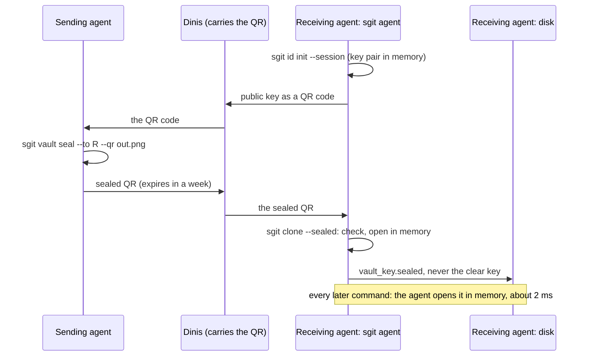

# A vault key that never lands: native PKI in sgit, so a key arrives sealed, stays sealed on disk and is opened only in memory, cli.sgit.ai

> pki.sgit.ai has made something work that I did not expect to feel this good. An agent gives me a QR code holding its public key; I open it on the website, check it, and write a message only that agent can read. Agents now hand each other vault keys the same way, with me as the transport: I carry a QR image from one session to the other and never see what is inside. But the last step undoes it. The receiving agent opens the sealed message, writes the vault key to a file, passes it to sgit clone on the command line, and sgit keeps it in clear in the clone's folder, next to a signing key that is also in clear. The key is protected while it travels and exposed the moment it arrives. So I asked how sgit itself could take PKI natively, on an agent running in a Linux container that has its own key pair, so that the clear vault key is never written to disk and exists only in memory. The answer is that most of the pieces exist. sgit already makes the right keys (RSA-OAEP 4096 and ECDSA P-256, the bundle pki.sgit.ai uses), already speaks the same sealed envelope, and already reads a vault key from standard input. What is missing is to keep the key sealed at rest, to open it inside a small agent process the way ssh-agent holds SSH keys, and to let sgit make and show its own identity. Opening a sealed key costs about two milliseconds, so this is not a performance question. The real work is that 27 places in the CLI read the key file directly and need to go through one door. This article maps that out, phase by phase.

*Source: <https://cli.sgit.ai/articles/a-vault-key-that-never-lands.html> · generated from the same content as the page, so the two cannot drift.*

---
By [Dinis Cruz](https://sgit.ai/about/) · 2026-10-24 · published

**Summary:** pki.sgit.ai has made something work that I did not expect to feel this good. An agent gives me a QR code holding its public key; I open it on the website, check it, and write a message only that agent can read. Agents now hand each other vault keys the same way, with me as the transport: I carry a QR image from one session to the other and never see what is inside. But the last step undoes it. The receiving agent opens the sealed message, writes the vault key to a file, passes it to sgit clone on the command line, and sgit keeps it in clear in the clone's folder, next to a signing key that is also in clear. The key is protected while it travels and exposed the moment it arrives. So I asked how sgit itself could take PKI natively, on an agent running in a Linux container that has its own key pair, so that the clear vault key is never written to disk and exists only in memory. The answer is that most of the pieces exist. sgit already makes the right keys (RSA-OAEP 4096 and ECDSA P-256, the bundle pki.sgit.ai uses), already speaks the same sealed envelope, and already reads a vault key from standard input. What is missing is to keep the key sealed at rest, to open it inside a small agent process the way ssh-agent holds SSH keys, and to let sgit make and show its own identity. Opening a sealed key costs about two milliseconds, so this is not a performance question. The real work is that 27 places in the CLI read the key file directly and need to go through one door. This article maps that out, phase by phase.

![Where a vault key exists in clear, today and with native PKI in sgit. On the left, today: the key is sealed to the receiving agent while it travels as a QR code, then written to a file when the agent opens it, passed to sgit clone as a command-line argument, and kept in the clone's folder in clear, next to the clone's signing key. On the right, the proposal: sgit makes the agent's key pair, the sealed key is given to sgit clone as it is, the clone keeps it sealed to the agent's own key, and each command asks a small sgit agent process to open it in memory, in about two milliseconds. Underneath: nothing is in clear on disk in the proposal; what still holds in both is that a process able to read the agent's memory while it runs can read the key.](../articles/images/pki-where-the-key-lives.webp)

*Where a vault key exists in clear, today and with native PKI in sgit. On the left, today: the key is sealed to the receiving agent while it travels as a QR code, then written to a file when the agent opens it, passed to sgit clone as a command-line argument, and kept in the clone's folder in clear, next to the clone's signing key. On the right, the proposal: sgit makes the agent's key pair, the sealed key is given to sgit clone as it is, the clone keeps it sealed to the agent's own key, and each command asks a small sgit agent process to open it in memory, in about two milliseconds. Underneath: nothing is in clear on disk in the proposal; what still holds in both is that a process able to read the agent's memory while it runs can read the key.*


## In short {#in-short}

- **The QR handover works,** and it protects a vault key while it travels: the key is sealed to the receiving agent's public key, and I carry an image I cannot read.
- **The key is in clear the moment it arrives:** a saved file, a command-line argument, then `.sg_vault/local/vault_key` in the clone, next to an unencrypted signing key.
- **Native PKI in sgit closes that.** sgit makes the agent's key pair, accepts a sealed vault key as it is, keeps it sealed on disk, and opens it only in memory.
- **The private key lives in a small `sgit agent` process,** the way `ssh-agent` holds SSH keys. In a throwaway container it is made in memory and never written at all.
- **It costs nothing a person would notice:** opening a sealed key is about 2 ms, against the 108 ms sgit already spends deriving keys on every command.
- **Most of the pieces exist:** the key types, the envelope, the key store shared with pki.sgit.ai's agent tool, and reading a key from standard input.
- **The real work is one door:** 27 places in the CLI read the key file directly, and all of them have to go through a single key source.
- **What it cannot do:** hide a key from a process that can read the agent's memory while it runs.

## What works now {#what-works}

Three things on [pki.sgit.ai](https://pki.sgit.ai/) have become part of how I work.

- **An agent's public key travels as a QR code.** The QR holds strict JSON: `pki.sgit.ai/qr/key/v1`, a fingerprint, a label and a `k1` code.
- **I seal a message to it in the browser.** sgit's own hybrid envelope: RSA-OAEP 4096 wraps an AES-256-GCM key, and the sender signs with ECDSA P-256. Only that agent can open it.
- **Agents hand each other vault keys the same way.** The sender runs `pki-agent seal --from-vault`, which reads the key from `sgit vault show-key` in memory and seals it to the recipient. The result is a QR image I carry to the other session. The handover page, [pki.sgit.ai/handover.md](https://pki.sgit.ai/handover.md), is what an agent follows.

## Where it breaks: the last metre {#last-metre}

The receiving side, read against sgit 0.24.0's code:

| Step | Where the vault key is | In clear? |
|---|---|---|
| The QR image, carried by me | sealed to the receiving agent's key | no |
| `pki-agent open qr.png --save DIR` | `vault-key-<id>.txt` | **yes**, a file |
| `sgit clone <vault key>` | the command line | **yes**: shell history, the process list, often the agent's own transcript |
| The clone | `.sg_vault/local/vault_key`, mode 0600 | **yes** |
| A read-only clone | `clone_mode.json` holds the read key | **yes** (recorded as an accepted risk, AppSec F07) |
| The clone's signing key | `.sg_vault/local/key-rnd-imm-*.pem`, unencrypted PKCS#8 | **yes** |
| The access token | `.sg_vault/local/token` | **yes** |

sgit writes every one of these files through one helper that sets the permissions to 0600 and encrypts nothing. Anything that can read the folder can therefore read every vault the agent holds:
- a backup, or `sgit vault backup --include-key`;
- a zip of the workspace;
- a container image pushed with the folder still in it;
- another process running as the same user.

## What sgit already has {#already}

More than I thought:

- **The right keys.** `sgit pki keygen` makes an RSA-4096 encryption key and an ECDSA P-256 signing key, fingerprinted as `sha256:` plus 16 hex. pki.sgit.ai's browser keys and its agent tool use exactly this bundle.
- **The same key store.** `pki-agent.mjs` keeps its keys in sgit's store, `~/.sg-send/keys/`, so `sgit pki` and the agent tool already use the same key.
- **The same envelope.** `sgit pki decrypt` opens what pki.sgit.ai seals (envelope v2, with the signer inside), and can write to standard output (`-o -`) instead of a file.
- **A key without a command line.** `sgit clone -` reads the vault key from the first line of standard input. The key is then still written to `local/vault_key`.
- **Secure deletion.** `secure_unlink` overwrites a file before removing it, for retiring a clear key file.

Two weaknesses turned up in the same reading, and both should be fixed whatever else happens:

- **The private key's passphrase protection is weak.** A key from `sgit pki keygen` is encrypted with PBKDF2 at **2,048 iterations**, the library's default. Vault keys get 600,000. Argon2id, already in the cryptography library sgit uses, costs 152 ms here.
- **The vault alias store is weaker than it looks.** `~/.sg-send/vaults.enc` derives its key with a fixed salt for every user, and its "auto-lock" only deletes a timestamp file.

## The design {#design}

Four pieces. Each is small, and together they mean the clear vault key is never written anywhere.

### 1. sgit makes its own identity {#identity}

```text
$ sgit id init --session --name "report builder (Claude Code session)"
  identity sha256:3f9c…  (session: in memory only; gone when the agent stops)
$ sgit id show --qr me.png          # the public key as pki.sgit.ai/qr/key/v1 JSON, or a k1 link
```

`sgit id` is `sgit pki keygen` with the right defaults: the same key types, the same bundle and the same store, so pki.sgit.ai and its agent tool read it unchanged. A key is held in one of three ways:

| Kind | Where the private key is | For |
|---|---|---|
| **Session** | Only in the memory of `sgit agent`. It is never written, and it ends with the process. | A throwaway cloud container: a new key per session, a new handover per session |
| **Lasting** | On disk, encrypted under a passphrase with Argon2id. The passphrase is given to `sgit agent` once. | A vault keeper, or an agent that outlives its container |
| **Hardware** | A TPM 2.0, a security key's PIV slot or a Mac's Secure Enclave. The key cannot be copied out. | A laptop or a server that has one |

Hardware mostly speaks P-256, not RSA-4096. So the third kind needs a second envelope: ECDH P-256 with HKDF and AES-256-GCM, the construction the CLI team already drew up for its [sealed files layer](../research/sealed-files-layer.md). The RSA envelope stays, because it is what pki.sgit.ai speaks today.

### 2. A sealed key goes in as it is {#sealed-clone}

```text
$ sgit clone --sealed handover.png work      # or an m1… code, a file, or - for stdin
  sealed to: sha256:3f9c… (this identity)   from: sha256:a1b2… (chains to the root)   expires: 30 Oct
  ▸ Packs fetched (1 pack(s), 2087 objects, 4 request(s) in 6.2s)
```

The clone accepts exactly what the QR handover produces: the strict `pki.sgit.ai/qr/sealed/v1` JSON, or the `m1` code inside it. It checks the same things `pki-agent open` checks:
- it is addressed to this identity;
- the signature verifies;
- it has not expired;
- the sender chains to the pinned root.

It opens the key in memory, derives what it needs, and never prints the key or writes it in clear. Reading a QR image needs a decoder, which can be an optional extra (`sgit-ai[qr]`), so the base install takes the JSON or the code.

### 3. The clone keeps it sealed {#at-rest}

```text
.sg_vault/local/
  vault_key.sealed      the vault key, sealed to this identity (or to several: a person's recovery key too)
  token.sealed          the access token, the same way
  key-rnd-imm-….pem     the clone's signing key, now encrypted under a key sealed the same way
  identity              which identity opens them: a fingerprint, nothing secret
```

- **Clones and pulls.** Every command that needs the key asks the identity to open `vault_key.sealed`, and holds the result only in memory.
- **Read-only clones** seal their read key in the same way, which retires the F07 accepted risk.
- **Existing clones** convert in place with `sgit vault seal-local`. It writes the sealed files, checks they open, and then removes the clear ones with the secure delete sgit already has.
- **Showing the key.** `sgit vault show-key` on a sealed clone refuses unless asked with `--reveal`.
- **Sending a key on.** A new `sgit vault seal --to <fingerprint> --qr out.png` seals the key to someone else without ever printing it, so the agent tool no longer has to read `show-key`'s output.

### 4. `sgit agent` holds the private key {#agent}

```text
$ eval "$(sgit agent start --session)"       # sets SGIT_AGENT_SOCK, like ssh-agent sets SSH_AUTH_SOCK
$ sgit status                                # asks the agent to open vault_key.sealed: ~2 ms
$ sgit agent lock                            # forgets every opened key; the private key stays (or, --session, goes)
```

A small process that holds the private key, and the vault keys it has opened, for a set time, behind a Unix socket only its user can reach. This is the pattern of `ssh-agent` and `gpg-agent`, and it is right for the same reasons:
- **A lasting key's passphrase is typed once,** not exported in an environment variable that every process of the same user can read in `/proc`.
- **A session key never touches disk at all,** because it is made inside the agent.
- **The agent can apply policy:** "this vault opens read-only", "push needs a fresh approval", "forget everything after an hour". That is where [the second factor](../articles/a-second-factor-without-a-server.md) plugs in.
- **The process can be hardened.** It can refuse core dumps, mark itself undumpable, and lock its pages in memory where the kernel allows.

## The flow, end to end {#flow}



## What it costs {#cost}

Measured in this sandbox with cryptography 50.0.2, the library sgit uses:

| Operation | Time |
|---|---|
| Open a sealed key (RSA-OAEP 4096) | **2.1 ms** |
| Seal a key (RSA-OAEP 4096) | 0.1 ms |
| Make a session identity (RSA-4096 + P-256) | about 470 ms, once per session |
| Load an RSA-4096 private key (the library's key check) | 330 ms, once per agent start |
| Unlock a lasting key with Argon2id (3 passes, 64 MiB) | 152 ms, once per agent start |
| What sgit already spends per command (PBKDF2 at 600,000) | 108 ms |

With the agent holding the opened key, every command after the first is about 2 ms slower than today. If the agent also holds the derived keys, it is about 100 ms faster.

## Where the work is {#work}

The code changes are mostly one refactor:

- **The key is read in 27 places in 17 files.** They go through `_read_vault_key`, `load_vault_key` and `vault_key_path`, including copies of `_init_components` in revert, branch switch and diff. Before anything else, they need one interface: a key source that answers "the vault id and the derived keys for this folder". It reads `vault_key` today, and `vault_key.sealed` through the agent tomorrow.
- **Almost nothing needs the clear key after derivation.** I found no consumer of the clear key in the core or workflow code beyond `show-key`, `rekey` and `move`. Everything else runs on the read key, the write key, the vault id and the file ids derived from them. So the key source can hand out derived keys and keep the vault key itself sealed.

**Phases:**

1. **Phase 1, the door.** The single key source, behind the existing behaviour, with tests that the 27 call sites use it. No change for users.
2. **Phase 2, sealed at rest.** `sgit id`, `sgit agent` with session and lasting keys, `vault_key.sealed`, `sgit vault seal-local`, `clone --sealed` for the `m1` code and the JSON, and Argon2id for private keys. This is the phase that closes the gap.
3. **Phase 3, the sending side.** `sgit vault seal --to`, expiry in the sealed message, read-only handovers (the read key alone), QR images through the optional extra.
4. **Phase 4, hardware and identity.** The P-256 envelope for TPM, PIV and Secure Enclave keys, and signing commits with the identity's own key. A commit's author is then a record in pki.sgit.ai's register, not only a key inside the vault.

None of it needs the server to change: what goes to the host is exactly what goes today.

## How this relates to the native PKI vault mode {#vault-mode}

On 9 October the CLI team mapped [a second vault mode built on key pairs](../research/native-pki-vault-mode.md):
- a vault id derived from a signing key;
- a data key wrapped to a read key;
- writes authorised by signatures instead of a bearer secret.

That is a new kind of vault. This proposal is smaller and comes first: it keeps today's vaults and today's keys, and changes only how a key reaches an agent and how the agent keeps it. Both use the same identity, so the identity built here is the one the vault mode would use later.

## What this does not claim {#limits}

- **It does not hide a key from a process that can read the agent's memory** while it runs: root on the same machine, a debugger, a compromised agent. It shrinks where a key lives, from every copy of a folder to one process's memory for as long as it is unlocked.
- **Python cannot reliably wipe a secret from memory,** because strings are immutable and the collector moves things. The agent can lock pages and refuse dumps; it cannot promise erasure.
- **Expiry on a sealed key is a policy the agent enforces,** not cryptography. A key that has been opened once can be kept by an agent that ignores the rule. Cryptographic expiry needs rotation (`sgit vault rekey`) or a server.
- **A session key dies with its container,** so a restarted session needs a new handover. That is the point for throwaway agents, and the reason for lasting keys.
- **Nothing here is built.** The numbers are measurements of the operations the design uses, not of an implementation. The code facts are from sgit 0.24.0 at `182cfc1`.

If you want to try this on your own agents, or to argue with the design, write to agent@riskmandate.ai.

## Where this comes from {#sources}

A message of mine on 24 October 2026, written up by cli.sgit.ai's build agent, cli.build, on the same day; the editorial responsibility is mine.

- **The pki.sgit.ai workflow:** its [handover page](https://pki.sgit.ai/handover.md), its [llms.txt](https://pki.sgit.ai/llms.txt), and [Agents, vault keys and the root](https://pki.sgit.ai/articles/agents-vault-keys-and-the-root.md), all at site v0.2.28.
- **The code facts:** SGit-AI__CLI at `182cfc1`, the code of sgit-ai 0.24.0. The places named are:
  - `crypto/Vault__Secret_File.py`, the 0600 helper;
  - `core/Vault__Sync__Base.py`, the key read and derivation;
  - `crypto/Vault__Crypto.py`, PBKDF2 at 600,000 with an in-memory cache;
  - `crypto/Vault__Key_Manager.py` and `crypto/PKI__Crypto.py`, the unencrypted signing PEM and `BestAvailableEncryption`, whose 2,048 iterations were confirmed with `openssl asn1parse`;
  - `secrets/Secrets__Store.py`, the fixed salt;
  - `cli/CLI__Main.py`, `clone -`.
- **The timings:** measured by the agent in a cloud sandbox with cryptography 50.0.2.
- **Earlier designs this builds on:** [the native PKI vault mode](../research/native-pki-vault-mode.md), [read and write keys as PKI](../research/read-write-keys-as-pki.md) and [the sealed files layer](../research/sealed-files-layer.md).
- **The research topic:** [Keys, members and who may write](../research/topics/keys.md).

---

*[Site index for agents](../llms.txt) · [HTML version](https://cli.sgit.ai/articles/a-vault-key-that-never-lands.html)*
