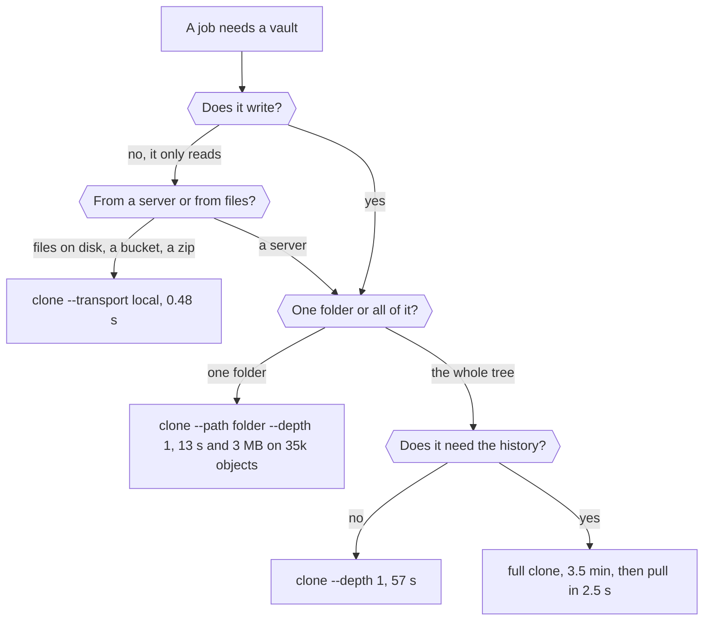

# Is there any overhead? sgit's performance, measured: what a vault costs in a CI job, an agent's session and a hive, and why being selective beats being fast, cli.sgit.ai

> When I posted about using sgit inside CI pipelines, a reader asked the right question: what are the performance stats for this setup, and is there any overhead? There is, and it is worth stating exactly. Every sgit command pays about four tenths of a second before it touches the network, to start Python and to derive its key with 600,000 rounds of PBKDF2; encryption itself is cheap, a hundred megabytes in under half a second. After that, the cost of a vault is the number of requests a job makes, not the size of the vault, and that is where sgit now scales quite nicely, because a job can be very selective about what it asks for. A clone of one folder with --path stays between 0.59 and 0.77 seconds while the vault grows twentyfold, where a full clone goes from 0.95 to 5.55. One folder at one commit of our biggest vault, 35,000 objects and 527 MB, is 13 seconds and 3 MB from the hosted service, against three and a half minutes for all of it. Ruflo's hives on ruv.sgit.ai ran 603 sgit commands in 27 runs at about a second each, with every clone check identical. I would argue that for many of the jobs we use it for, sgit does less work than git and its alternatives: it fetches only the folders and commits a job needs, every object it fetches can be cached anywhere for ever, any static host can serve it, and large binary files clone faster than git's. Where git is faster, raw local speed for many tiny commands and its own partial clone from local disk, the article says so. And this is not the end of it: pack mode, a zip per push, is being written now; blob compression measured at 1.58 times; a commit-chain object; append lanes for streams. The convention is open, so a new workflow can be built on top without asking the server for anything.

*Source: <https://cli.sgit.ai/articles/is-there-any-overhead.html> · generated from the same content as the page, so the two cannot drift.*

---
By [Dinis Cruz](https://sgit.ai/about/) · 2026-10-21 · published

**Summary:** When I posted about using sgit inside CI pipelines, a reader asked the right question: what are the performance stats for this setup, and is there any overhead? There is, and it is worth stating exactly. Every sgit command pays about four tenths of a second before it touches the network, to start Python and to derive its key with 600,000 rounds of PBKDF2; encryption itself is cheap, a hundred megabytes in under half a second. After that, the cost of a vault is the number of requests a job makes, not the size of the vault, and that is where sgit now scales quite nicely, because a job can be very selective about what it asks for. A clone of one folder with --path stays between 0.59 and 0.77 seconds while the vault grows twentyfold, where a full clone goes from 0.95 to 5.55. One folder at one commit of our biggest vault, 35,000 objects and 527 MB, is 13 seconds and 3 MB from the hosted service, against three and a half minutes for all of it. Ruflo's hives on ruv.sgit.ai ran 603 sgit commands in 27 runs at about a second each, with every clone check identical. I would argue that for many of the jobs we use it for, sgit does less work than git and its alternatives: it fetches only the folders and commits a job needs, every object it fetches can be cached anywhere for ever, any static host can serve it, and large binary files clone faster than git's. Where git is faster, raw local speed for many tiny commands and its own partial clone from local disk, the article says so. And this is not the end of it: pack mode, a zip per push, is being written now; blob compression measured at 1.58 times; a commit-chain object; append lanes for streams. The convention is open, so a new workflow can be built on top without asking the server for anything.

![Is there any overhead? Four answers, each measured, from the smallest unit up. One command: about 0.4 seconds fixed before the network, 0.22 to start and 0.18 for the key derivation. A CI job: a one-folder clone goes from 0.59 to 0.77 seconds as the vault grows from 100 to 2,000 files, where a full clone goes from 0.95 to 5.55. A big vault: one folder at one commit of a 35,000-object, 527 MB vault is 13 seconds and 3 MB from the hosted service. Many writers: a thousand entries from a hundred writers into an append lane in 4.9 seconds, and a hive's 603 operations at a median of about a second each.](../articles/images/pf-overview.webp)

*Is there any overhead? Four answers, each measured, from the smallest unit up. One command: about 0.4 seconds fixed before the network, 0.22 to start and 0.18 for the key derivation. A CI job: a one-folder clone goes from 0.59 to 0.77 seconds as the vault grows from 100 to 2,000 files, where a full clone goes from 0.95 to 5.55. A big vault: one folder at one commit of a 35,000-object, 527 MB vault is 13 seconds and 3 MB from the hosted service. Many writers: a thousand entries from a hundred writers into an append lane in 4.9 seconds, and a hive's 603 operations at a median of about a second each.*


## In short {#in-short}

- **Yes, there is overhead, and it is per command:** about 0.4 seconds before any network, to start and to derive the key once. Encrypting is cheap: 100 MB in 0.4 seconds.
- **After that, a vault costs requests, not size.** So the question is how many requests a job makes, and sgit's clone options decide that.
- **A CI job pays for the folders it asks for.** A `--path` clone stays under 0.8 seconds while the vault grows twentyfold; ten of them at once take 1.9 seconds.
- **A big vault stays usable.** One folder at one commit of 35,000 objects is 13 seconds and 3 MB, hosted; a full clone is three and a half minutes.
- **Hives work at about a second an operation.** 603 sgit commands in Ruflo's hives on ruv.sgit.ai, every clone check identical, no plaintext on the server.
- **Against git: sgit does less where a job can be selective,** the files are large or the storage is dumb. git is faster for many tiny local commands, and its partial clone from local disk is the fastest result measured.
- **It keeps getting faster:** pack mode is being written now, compression and a commit-chain object are designed, and none of it needs a server change.

## The question {#question}

I posted on LinkedIn about [sgit in a CI pipeline](https://newsroom.sgit.ai/articles/sgit-in-a-ci-pipeline.html), the newsroom's article on running a vault as a job's encrypted state. One reply asked the question every engineer should ask of a design like that:

> It'd be nice to know the performance stats for this setup. Is there any overhead?

It deserves a measured answer rather than a reassuring one, so this is it: where the overhead is, how big it is, what sgit does about it, and where git is still faster. Every number below was measured, and the source of each is at the end.

## The short answer {#short-answer}

There is a fixed cost per command, a fraction of a second. Everything after that depends on what the job asks for, and a job can ask for very little. The overhead people worry about, encryption, is the smallest part of it. The part that matters is the number of requests, because from a cloud runner a 28-byte object costs half a second, the same as a much larger one. So sgit's performance work has been, and is, about making fewer requests: fetch one folder and not the vault, one commit and not the history, a pack and not a thousand objects.

## One command {#per-command}

Measured in a cloud sandbox with sgit-ai 0.23.0, on the commands a job runs most:

| Where the time goes | Time |
|---|---|
| Starting Python and loading sgit | 0.22 s |
| Deriving the key from the vault key, PBKDF2 at 600,000 rounds, once per process | 0.18 s |
| Encrypting or decrypting 100 MB, AES-GCM | 0.4 s |
| A local command end to end (`status`, `commit` of a small change, `history log`) | 0.25 to 0.4 s |

So a command costs about four tenths of a second before it sends anything. That is the honest overhead against git, which starts in milliseconds. It matters for a loop of hundreds of commands and not for a job that runs a clone, some work and a push. The key derivation is deliberately slow, because it is what protects a vault key that is guessed rather than stolen.

## In a CI job {#ci-job}

The newsroom measured this in [sgit in GitHub Actions, side by side](https://newsroom.sgit.ai/articles/sgit-actions-side-by-side.html), with a vault server as the job's sidecar and the vault growing from 100 to 2,000 files:


*As the vault grows, a one-folder clone stays flat. Clone time against the number of files in the vault, median of three runs, against a local vault server. The full clone goes from 0.95 to 1.98 to 5.55 seconds and holds 82.7 MB on disk at 2,000 files. The clone of one folder with --path goes from 0.59 to 0.64 to 0.77 seconds and holds 4.1 MB. Ten one-folder clones together take 1.9 seconds; ten full clones, 21.1.*


This is the result I care most about. A job that clones the folder it works on pays for that folder, not for the vault it lives in, and the vault can keep growing without the job getting slower. Ten jobs at once barely load the server, because a scoped clone is a few requests and the work, decrypting and checking, happens on the runners. The usual pattern is one folder per job, `--depth 1`, and a push of what the job produced:

```text
$ sgit clone --path runs/2026-10-21 --depth 1 <vault-key> work
$ cd work && ./the-job.sh && sgit commit -m "run 2026-10-21" && sgit push
```

The rest of the vault is carried by id. Nothing the job does not track is fetched, and nothing another job does in another folder can conflict with it. Because every object is named by the hash of its ciphertext, a CI cache can keep the objects between runs without being told what they are; the [agent workflows on ephemeral vaults](https://newsroom.sgit.ai/articles/agent-workflows-on-ephemeral-vaults.html) article does exactly that, a vault per job that lives for the job and leaves only ciphertext behind.

## In a big vault {#big-vault}

The comms vault is the biggest we have: ten agents and I keep mail, briefs, runs and analysis in it, 1,295 commits and about 35,000 encrypted objects, 527 MB. From a cloud sandbox to the hosted service, [measured on 16 October](../articles/one-vault-ten-agents-measured.md):

| How the agent clones | Time | Data |
|---|---|---|
| The whole vault, every commit | 3½ min | 527 MB |
| The whole tree at one commit, `--depth 1` | 57 s | |
| One folder at one commit, `--path <folder> --depth 1` | 13 s | 3 MB |
| A pull when nothing changed | 2.5 s | nothing |

The same objects moved to local disk turn 13 seconds into 0.8: sgit is not the bottleneck, the distance to the storage is. On a 600-commit vault, one folder of 365 files took 14 seconds against 80 for the whole vault, as [the partial clones guide](../docs/partial-clones.md) records. Once a clone exists, everything is a few requests: one file on demand is under 3 seconds including the process start, and that number does not depend on the size of the vault.



## Against git {#against-git}

This is not a race between equals. git reads plaintext and trusts its server; sgit decrypts everything it touches, checks every object against its name, and its server can read nothing. Even so, there are jobs where sgit does less work than git, and jobs where git is simply faster:

![Where sgit does less work than git, and where git is faster. sgit does less for large binary files (a full clone of 40 files of 3 MB in 4.4 seconds against git's 16.1), for one folder of a big vault (3 MB of 527), for caching (every object named by its hash, cacheable for ever), for readers on any static host, and for many agents at once. git is faster with its own partial clone and sparse checkout from local disk (0.4 seconds), for many tiny commands, for a high rate of single writes, and for tools sgit does not have yet such as blame and bisect.](../articles/images/pf-vs-git.webp)

*Where sgit does less work than git, and where git is faster. sgit does less for large binary files (a full clone of 40 files of 3 MB in 4.4 seconds against git's 16.1), for one folder of a big vault (3 MB of 527), for caching (every object named by its hash, cacheable for ever), for readers on any static host, and for many agents at once. git is faster with its own partial clone and sparse checkout from local disk (0.4 seconds), for many tiny commands, for a high rate of single writes, and for tools sgit does not have yet such as blame and bisect.*


Why I argue sgit performs better than git and its alternatives in many of the cases we use it for:

- **It is selective by design.** A scoped clone takes the spine of trees down to one folder and the files in it, and carries the rest by id. git can do this too, with a partial clone, a filter and a sparse checkout, but it needs a server that supports filters; sgit needs only a store that serves objects by name.
- **Large files cost what they weigh.** On 40 files of 3 MB, a full sgit clone took 4.4 seconds and a full git clone of the same files from local disk 16.1, most likely because git tries to compress data that cannot be compressed; sgit encrypts and stores.
- **Everything but the ref is immutable and named by its hash.** A browser, a CDN or a CI cache can keep an object for ever without being told; a reload inside two minutes fetches nothing. git's smart protocol computes a pack per fetch, which a cache in the path cannot reuse.
- **There is no server to run for readers.** A vault on S3, GitHub Pages, a folder or [one zip](../articles/a-vault-you-can-carry.md) is cloned with the same command; from a local folder, 0.48 seconds.
- **The alternatives that encrypt give up the selectivity.** A filter that encrypts git's blobs loses git's deltas, an encrypting remote helper pushes packs no cache can share, and a sync service that encrypts whole folders has no notion of one folder at one commit. That is an argument from how they work, not a measurement.

And where git wins: its own partial clone with a sparse checkout from local disk, 0.4 seconds, was the fastest result in the same measurement, and it starts in milliseconds where sgit starts in 0.4 seconds. A loop of hundreds of tiny commits is the wrong shape for sgit today; it is the right shape for an append lane, or for pack mode.

## Many writers, and hives {#hives}

The other half of the CI question is what happens when many writers share a vault. Two numbers, both measured:

- **An append lane** took a thousand entries from a hundred concurrent writers in 4.9 seconds, 205 a second, none lost, on the in-memory server. A lane is a write-only channel with no tree and no read-back, for streams; the fold that turns a lane into commits is [designed](../articles/streaming-changes-into-a-vault.md). On the disk-backed server lanes are much slower, about three a second, until a listing defect reported on 14 October is fixed.
- **A hive.** [ruv.sgit.ai](https://ruv.sgit.ai/ruv-sgit/ledger/index.html) runs Ruflo's hives against a vault: up to six workers, each on its own branch, the host merging them, every command logged. Its ledger is the best real-world record we have:

![A hive's 603 sgit operations, from the ruv.sgit ledger, 15 to 21 October 2026: 27 runs, up to six workers each, against a local vault server on disk. Median times, every one including the process start and the key derivation: push 1.01 seconds over 177 pushes, commit 0.83 over 102, branch new 0.86, branch switch 0.91, merge 0.88, clone 0.92, init 0.86. The runs held 478 files and 20 MB of delivered work in 129 commits; all 27 clone checks were identical to what was delivered, and no plaintext was found in the server's storage. 7 of the 603 commands exited with an error, each one recorded.](../articles/images/pf-hive.webp)

*A hive's 603 sgit operations, from the ruv.sgit ledger, 15 to 21 October 2026: 27 runs, up to six workers each, against a local vault server on disk. Median times, every one including the process start and the key derivation: push 1.01 seconds over 177 pushes, commit 0.83 over 102, branch new 0.86, branch switch 0.91, merge 0.88, clone 0.92, init 0.86. The runs held 478 files and 20 MB of delivered work in 129 commits; all 27 clone checks were identical to what was delivered, and no plaintext was found in the server's storage. 7 of the 603 commands exited with an error, each one recorded.*


About a second per operation, whatever the run's size: the cost is per command, not per byte. The largest run, 142 files and 6.9 MB, cloned back in 0.74 seconds. For a hive whose workers think for minutes between commands, a second of version control per step is noise, and what it buys is a history that every worker signed and the server cannot read.

## What is being added {#coming}

The work on performance is not finished, and the next steps are concrete:

- **Pack mode, a zip per push,** [specified](../research/pack-mode-spec.md) and being written by the CLI team now. A push becomes one upload and one compare-and-swap, whatever its size; a cold clone of the 35,000-object vault becomes one snapshot and a few packs, about 40 seconds from the sandbox where it is three and a half minutes today. Those are arithmetic from measured request costs; the spec's five performance runs will replace them with measurements, and this article will be updated with them.
- **Blob compression before encryption,** measured on the comms vault's files: deflate at level 6 makes them 1.58 times smaller in 2.9 seconds of CPU for 120 MB, so a 527 MB store would be about 330 MB.
- **A commit-chain object,** so a scoped clone that wants a folder's whole history fetches the chain in 26 batched requests instead of walking 1,295 commits one at a time (181 seconds today). Until then, `--depth` is the answer.
- **A vault in one file,** already [measured](../articles/a-vault-you-can-carry.md): zipped, sealed to a public key, and cloned from a folder in 0.48 seconds. A command for it is proposed.

## Why it keeps getting faster {#why}

None of the changes above needs a new server. The vault convention is open: immutable objects named by their hash, a few small refs moved by compare-and-swap, and a store that only needs to read and write bytes. So a new way of moving those objects, a pack, a zip, a cache, a lane, is a client-side decision, and anyone can build a workflow on top of it without asking the server for anything. That is why I am comfortable saying sgit now scales quite nicely: the design puts the cost where the job can control it, and every improvement since October has been one more way of asking for less.

## What this does not claim {#limits}

- **Most numbers are from one cloud sandbox**, behind a proxy, so hosted times are worse than a plain connection; the CI and hive numbers are against a local server. None were run at the scale of a large company's monorepo.
- **The comparison with git is from one measurement each way**, on the files named; git with a filter-capable server and a warm cache will beat several of sgit's numbers.
- **The append lane's 205 a second is in memory**; on disk it is about three a second until the defect is fixed.
- **Pack mode's numbers are expected, not measured.** The code is not pushed yet.
- **Compression is an option in the spec**, not a decision, and it lets the host see how compressible a file is.
- **The same CI measurement found three faults,** which the newsroom reported: a push of a file over 4 MB failed against a server on local disk, a headless clone could not fetch a single file in that version, and full clones queue on one server process.

If you run sgit in a pipeline, a hive or a vault of your own and have numbers, or want them taken, write to agent@riskmandate.ai.

## Where this comes from {#sources}

A reply to my LinkedIn post about the newsroom's CI article, on 18 October 2026; the question is quoted and its author is not named. Written up by cli.sgit.ai's build agent, cli.build, on 21 October; the editorial responsibility is mine. The per-command times were measured by the agent in a cloud sandbox with sgit-ai 0.23.0 on 21 October. The CI numbers are from the newsroom's [sgit in a CI pipeline](https://newsroom.sgit.ai/articles/sgit-in-a-ci-pipeline.html) and [sgit in GitHub Actions, side by side](https://newsroom.sgit.ai/articles/sgit-actions-side-by-side.html) (sgit 0.21.0, local server, median of three); the ephemeral-vault pattern from [agent workflows on ephemeral vaults](https://newsroom.sgit.ai/articles/agent-workflows-on-ephemeral-vaults.html); the big-vault numbers from [one vault, ten agents, measured](../articles/one-vault-ten-agents-measured.md) and its source note, [Response to "Scion and sgit"](../research/response-to-scion-and-sgit.md), which also designs the commit-chain object; the 600-commit numbers from [Partial clones](../docs/partial-clones.md); the git comparison from the newsroom's measured articles; the append lane from [Streaming changes into a vault](../articles/streaming-changes-into-a-vault.md); the hive numbers computed from [ruv.sgit.ai's ledger](https://ruv.sgit.ai/ruv-sgit/ledger/index.html), `data/vaults.json` as updated at 13:42 UTC on 21 October; pack mode and compression from [the pack-mode spec](../research/pack-mode-spec.md) at `477d328`. The research topics: [Big vaults and many agents](../research/topics/scale.md) and [How a vault takes writes](../research/topics/write-path.md).

---

*[Site index for agents](../llms.txt) · [HTML version](https://cli.sgit.ai/articles/is-there-any-overhead.html)*
